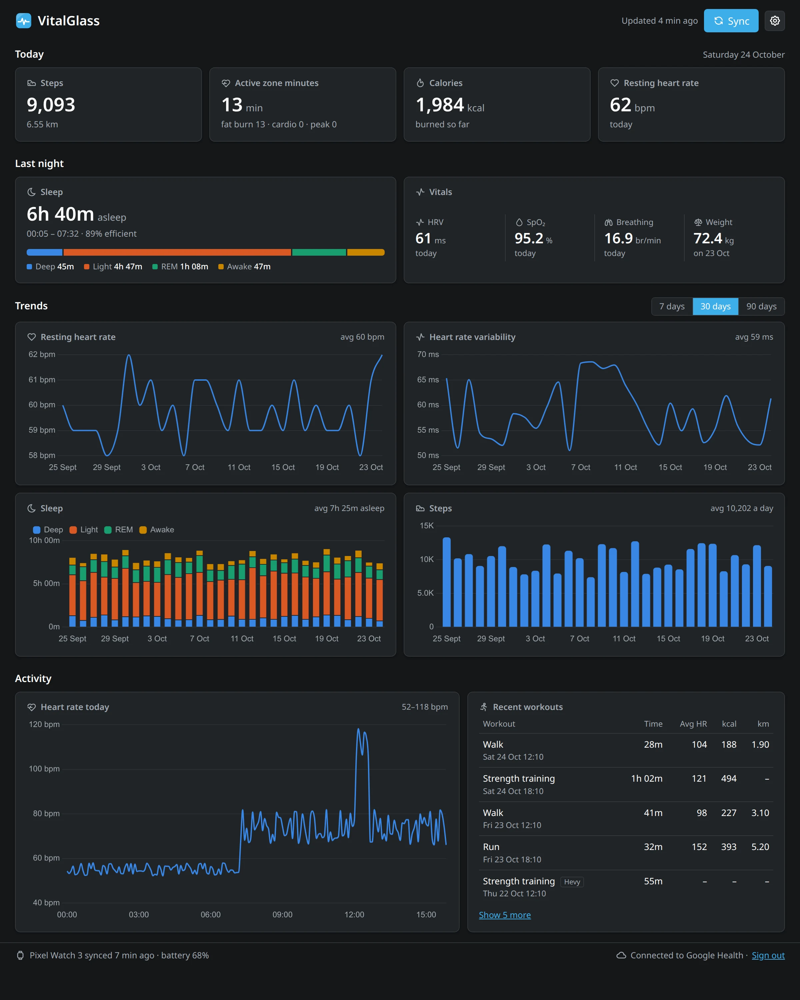
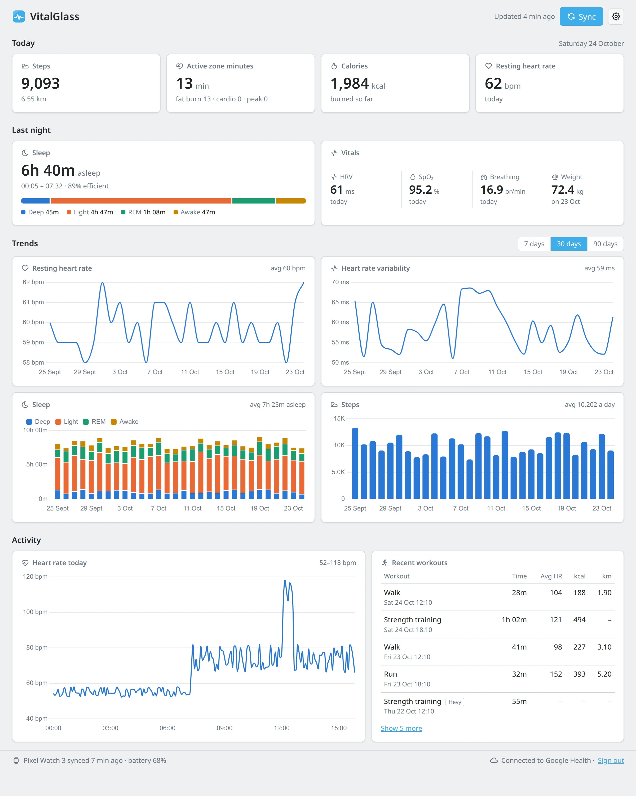
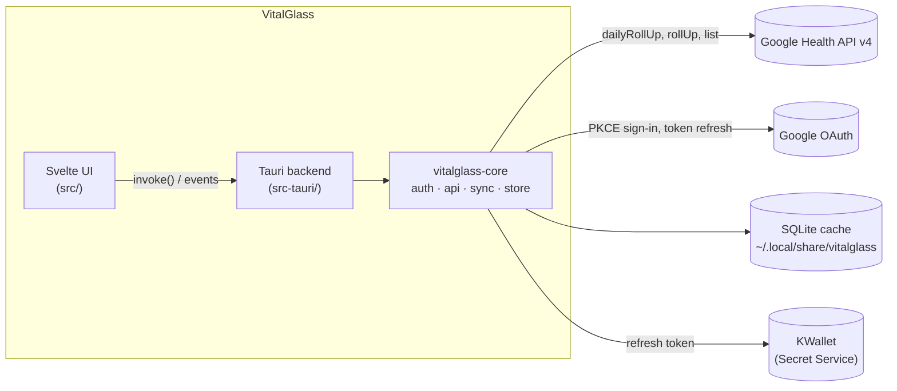

<p align="center">
  
</p>

<h1 align="center">VitalGlass</h1>

<p align="center">
  A desktop dashboard for your own Google Health data: steps, heart rate, sleep and workouts at a glance, without reaching for your phone.
</p>

<p align="center">
  
</p>

VitalGlass reads the data your Fitbit or Pixel Watch syncs to the Google Health app, through the new **Google Health API (v4)**, the successor to the Fitbit Web API. It's built for one person, runs locally, and only ever reads. Your health data stays on your machine except for the requests to Google that fetch it.

It's written in Rust and TypeScript with [Tauri v2](https://v2.tauri.app/) and [Svelte 5](https://svelte.dev/), and made to feel at home on KDE Plasma.

> The screenshots use VitalGlass's built-in mock mode with generated data, not real health data.

## Features

- **Today at a glance:** steps and distance, Active Zone Minutes, calories and resting heart rate.
- **Last night:** sleep duration, bed and wake times, efficiency and stages (deep, light, REM, awake), plus overnight HRV, SpO₂ and breathing rate. VO₂ max and weight appear when you have them.
- **Trends** over 7, 30 or 90 days: resting heart rate, HRV, sleep stages and steps.
- **Today's heart rate** in 5-minute averages, and your **recent workouts** with duration, average heart rate, calories and distance. Workouts logged by other apps through Health Connect (e.g. Hevy) are labelled.
- **Works offline.** Everything is cached in a local SQLite database, so the app opens instantly with your last-known data and refreshes in the background.
- **Syncs on its own** on launch, every 15 minutes, or when you press Sync. Closing the window keeps it running in the system tray.
- **Fits into Plasma.** Breeze Dark and Breeze Light themes, following your Plasma colour scheme and accent colour automatically, or chosen by hand.
- **Fails gracefully.** Missing permissions, an expired sign-in, an unlinked account or no network each get a clear message and a one-click fix, never a crash.

<details>
<summary>Breeze Light</summary>
<p align="center">
  
</p>
</details>

## How it works



- **The dashboard only reads from the local cache.** A background sync fills it, so the UI is never waiting on the network.
- **Sync runs in two passes.** A *hot* pass re-fetches the last 14 days of every data type, because recent data keeps changing as the watch syncs. A *backfill* pass then fills in history back to 90 days, split into chunks that respect each data type's range limit and resumable if it's interrupted.
- **Sign-in uses Google's installed-app flow.** The system browser opens with PKCE and returns to a loopback address (`127.0.0.1` on a random port). Only the refresh token is stored, in the OS keyring. Access tokens stay in memory and are refreshed when they expire.

### Repository layout

| Path | What's there |
|---|---|
| [`crates/vitalglass-core`](crates/vitalglass-core/src) | Everything that isn't UI: config loading, OAuth (`auth.rs`), the API client with retry and backoff (`api.rs`), typed models, unit conversion, the SQLite store and its migrations (`store/`), and the sync engine (`sync.rs`). |
| [`crates/vitalglass-cli`](crates/vitalglass-cli/src/main.rs) | A command-line tool that uses the same core: `sync`, `summary` and `status`. Handy for debugging without the UI. |
| [`src-tauri`](src-tauri/src) | The desktop app's Rust side: commands the UI calls, the background sync runner and timer, the tray icon, and Plasma theme detection. |
| [`src`](src) | The Svelte 5 frontend: dashboard, Chart.js charts, themes (`themes.css`), and a dev-only mock backend (`mock.ts`). |
| [`packaging`](packaging), [`Makefile`](Makefile) | Desktop entry and the local install. |

## Setting it up

You need a Google account that's signed in to the **Google Health** app on your phone, with a Fitbit or Pixel Watch syncing to it. VitalGlass is developed on Arch Linux with KDE Plasma (Wayland). Other Linux desktops should work; other operating systems haven't been tried.

### 1. Install the build tools

```bash
sudo pacman -S --needed rustup nodejs npm webkit2gtk-4.1 base-devel openssl libayatana-appindicator librsvg
```

```bash
rustup default stable
```

On other distributions, see Tauri's [Linux prerequisites](https://v2.tauri.app/start/prerequisites/#linux).

### 2. Create your own Google Cloud OAuth client

Each user creates their own OAuth client; none is shipped with the app.

1. Create a new project in the [Google Cloud console](https://console.cloud.google.com/).
2. Enable the **Google Health API** for it.
3. Under **Google Auth Platform → Branding**, give the app a name and your email.
4. Under **Audience**, choose **External**, leave the publishing status as **Testing**, and add your own Google account as a **test user**.
5. Under **Data Access**, add these five read-only scopes:
   - `https://www.googleapis.com/auth/googlehealth.activity_and_fitness.readonly`
   - `https://www.googleapis.com/auth/googlehealth.health_metrics_and_measurements.readonly`
   - `https://www.googleapis.com/auth/googlehealth.sleep.readonly`
   - `https://www.googleapis.com/auth/googlehealth.profile.readonly`
   - `https://www.googleapis.com/auth/googlehealth.settings.readonly`
6. Under **Clients**, create an OAuth client of type **Desktop app** and download its JSON file.
7. Put it where VitalGlass looks for it. It is never read from the repository.

```bash
install -Dm600 ~/Downloads/client_secret_*.json ~/.config/vitalglass/client_secret.json
```

Google's own guide is at [developers.google.com/health/setup](https://developers.google.com/health/setup).

### 3. Build and install

```bash
make install
```

This builds a release binary and installs it into `~/.local`: the binary, icons and a launcher entry. Open **VitalGlass** from your app menu and sign in. `make uninstall` removes it again; your cached data and sign-in are left alone.

To run it from the source tree instead, with hot reload:

```bash
npm install
```

```bash
npm run tauri dev
```

## Using it

- **Sync** fetches new data immediately. Otherwise VitalGlass syncs on launch and every 15 minutes while it's running.
- **Closing the window** hides VitalGlass to the system tray, where it keeps syncing. Use **Quit** in the tray menu, or press **Ctrl+Q** in the window, to exit.
- **The gear button** picks a theme. **System** follows your Plasma colour scheme and accent colour.
- **"Updated…"** in the header is when VitalGlass last fetched from Google. The footer shows when your watch last synced to your phone; the API only has data up to that point.

The command-line tool works from the same cache and sign-in:

```bash
cargo run -p vitalglass-cli -- sync
```

```bash
cargo run -p vitalglass-cli -- summary
```

## Privacy and security

- **Read-only.** VitalGlass requests read-only scopes and never writes to your Google account.
- **Local only.** Data goes from Google's API to `~/.local/share/vitalglass/vitalglass.db` (folder mode `0700`, file mode `0600`) and nowhere else. There's no telemetry and no server of its own.
- **Credentials stay out of files.** The refresh token is stored in KWallet through the Secret Service API, never in a plain file. Signing out revokes it at Google and removes it from the keyring.
- **Nothing private in the repository.** `.gitignore` excludes client secrets, tokens, databases and API dumps, and the screenshots use generated data.

## Things learned about the Google Health API

The v4 API is new, and a few behaviours weren't obvious from the docs:

- **Local-date fields are often missing.** The `civilStartTime` / `civilEndTime` fields are frequently absent from sleep and exercise sessions. Using the UTC date puts New Zealand mornings on the previous day, so VitalGlass works out the local date from each timestamp and its `utcOffset` ([`units::civil_date`](crates/vitalglass-core/src/units.rs)).
- **Health Connect echoes sessions back.** Data synced through Health Connect from Google's own fitness app (`com.google.android.apps.fitness`) duplicates Fitbit walks and shows up as short "naps" overlapping real sleeps. VitalGlass stores every session's source and hides those echoes in a database view, while keeping genuine Health Connect apps such as Hevy ([migration 2](crates/vitalglass-core/src/store/002_session_sources.sql)).
- **Numbers often arrive as strings.** 64-bit integers come as JSON strings (`"countSum": "12183"`), and distances and elevations are in millimetres.
- **Days with nothing are left out.** Daily rollups skip days with no value, so a day with steps but no Active Zone Minutes means zero minutes, not missing data.
- **There's no sleep score.** The API doesn't expose one, so VitalGlass shows sleep efficiency (time asleep ÷ time in bed) instead.
- **Transient errors happen.** `500` and `503` responses are common enough that every request retries them with exponential backoff and jitter, as well as `429` and `504`.
- **Filters use underscores.** List filters use underscored data-type names (`daily_resting_heart_rate.date >= "2026-10-01"`), while URLs use hyphens.

## Development

```bash
make check
```

This runs `cargo fmt --check`, clippy (with warnings treated as errors), the Rust tests and `svelte-check`.

**Mock mode** runs the UI in a normal browser with generated data, with no Google sign-in and no real data. It's useful for design work and is never included in release builds.

```bash
npx vite --port 5174
```

Then open `http://localhost:5174/?mock` (add `&theme=breeze-light&range=7` to preselect a theme and range). Port 5174 keeps 5173 free for `npm run tauri dev`.

**Adding a theme** takes one block of colour tokens in [`src/themes.css`](src/themes.css) and one entry in [`src/lib/theme.svelte.ts`](src/lib/theme.svelte.ts). Check the four chart colours for colour-blind separation and contrast against the theme's background.

## Troubleshooting

| Symptom | Fix |
|---|---|
| Blank window or `Error 71 (Protocol error) dispatching to Wayland display` | A WebKitGTK bug with NVIDIA on Wayland. VitalGlass already sets `WEBKIT_DISABLE_DMABUF_RENDERER=1`; if you've set it to something else yourself, unset it. |
| "Account not linked" | Sign in to the Google Health app on your phone with the same Google account, then press Retry. |
| "Session expired" every week | While the OAuth consent screen is in **Testing**, Google expires refresh tokens after 7 days. Sign in again, or move the consent screen to **In production** (you'll see an "unverified app" warning once). |
| "Permission not granted" on some cards | You unticked a scope on Google's consent screen. Use **Re-authorise** and leave all five ticked. |
| "Keyring unavailable" | VitalGlass needs a Secret Service provider (KWallet or GNOME Keyring) that's running and unlocked. |
| `npm run tauri dev` says port 5173 is in use | Another Vite server is running. Stop it, or use port 5174 for mock mode. |
| Launching does nothing | VitalGlass is already running in the tray; a second launch just brings that window forward. |

## Licence

[MIT](LICENSE). Use, change and share the code freely; it comes with no warranty.

---

VitalGlass is a personal project. It isn't affiliated with or endorsed by Google or Fitbit.
